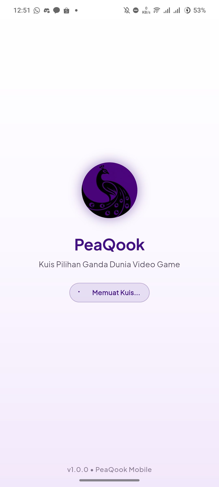
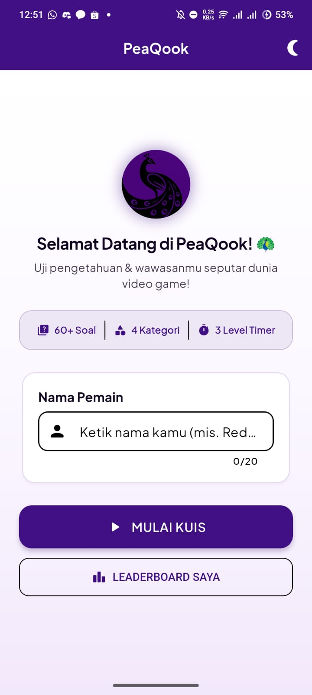
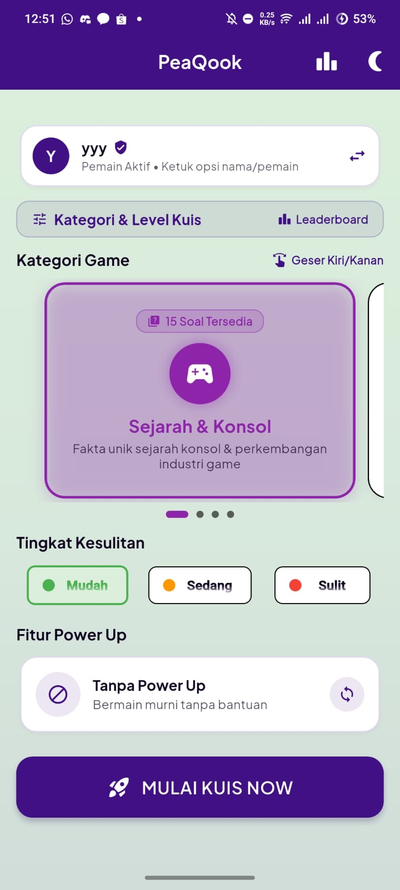
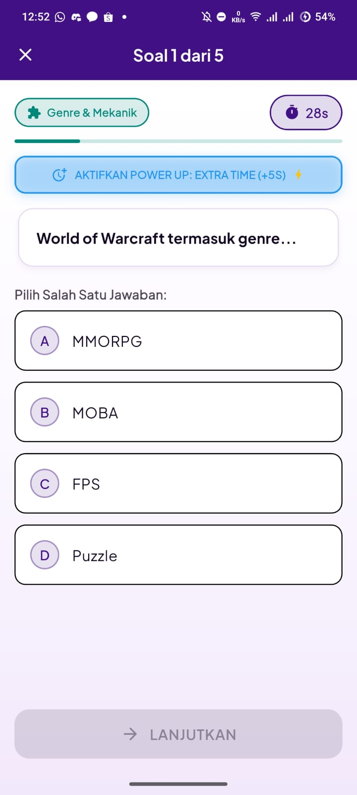
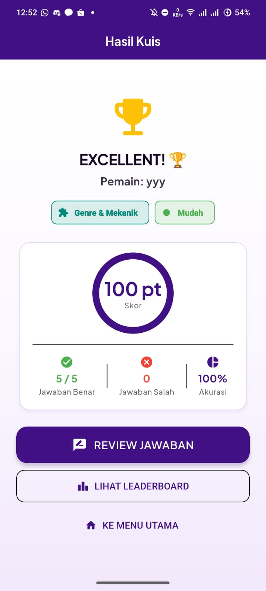
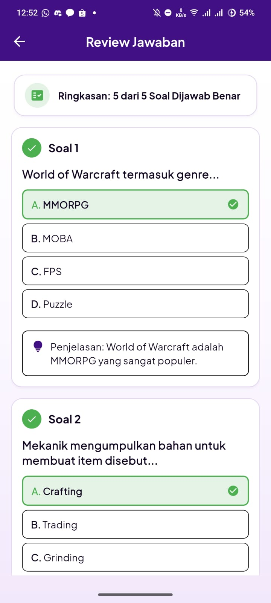
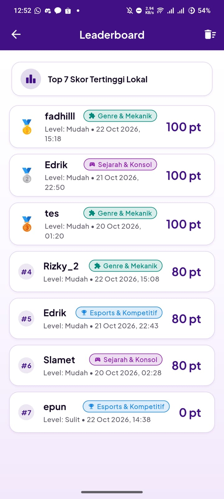

# 🦚 PeaQook — Quiz App bout Game world
> **Mata Kuliah**: Praktikum Pemrograman Mobile

---

## Identitas
- **Nama**: Muhammad Rizky Fadhillah
- **NIM**: 241401055
- **Lab**: Lab Pemrograman Mobile 1

---

## Informasi Aplikasi

### i. Nama Aplikasi
### **PeaQook**

### ii. Deskripsi Singkat Aplikasi
**PeaQook** adalah aplikasi kuis pilihan ganda interaktif berbasis mobile yang mengangkat tema **Dunia Video Game**. Aplikasi ini dirancang untuk menguji wawasan pengguna seputar sejarah konsol, mekanik game, karakter ikonik, hingga dunia esports. Dibangun menggunakan **Flutter** dan **Provider** untuk state management, PeaQook menawarkan pengalaman bermain yang mulus, responsif, dan kaya fitur tanpa memerlukan koneksi database eksternal.

### iii. Fitur-fitur yang Tersedia
1. **Splash Screen Beranimasi**: Menyambut pengguna dengan animasi *fade & scale* serta memuat bank soal (`questions.json`) secara *async*.
2. **Home Screen Interaktif**: Dilengkapi input nama pemain dengan validasi ketat, tombol mulai, navigasi leaderboard, dan tombol *toggle* tema.
3. **Horizontal Swipeable Carousel (Category Screen)**: Memilih kategori game melalui kartu besar di tengah yang dapat digeser ke kiri/kanan (`PageView`), lengkap dengan indikator titik animasi dan tingkat kesulitan (*Mudah, Sedang, Sulit*).
4. **Fitur Power-Up Kuis**: Tiga pilihan Power Up (*Tanpa Power Up*, *Extra Time +5s*, dan *Question Slayer*) yang dapat diputar (*cycle*) dan diaktifkan saat kuis berlangsung.
5. **Quiz Screen Dinamis**: Kuis interaktif dengan timer hitung mundur per soal, *progress bar*, pencegah keluar tak sengaja (`PopScope`), serta tombol aktivasi Power-Up.
6. **Result & Review Screen**: Ringkasan skor akhir, akurasi, tier pencapaian (*Excellent, Good, Keep Trying*), serta halaman review jawaban lengkap dengan penjelasan detail per soal.
7. **Leaderboard Lokal**: Penyimpanan daftar top 20 skor tertinggi secara persisten menggunakan `SharedPreferences`.
8. **Dual Theme (Light & Dark Mode)**: Mendukung mode terang dan gelap yang dapat diubah secara instan dan tersimpan otomatis.
9. **Desain Responsif & Adaptif**: Nyaman digunakan di berbagai ukuran layar HP, tablet, maupun orientasi *landscape*.

---

## 📚 Dokumentasi

### i. Credit Aset yang Digunakan
- **Logo Aplikasi**: Logo siluet Peacock alias burung merak, pas kaya namanya. (`Final_icon.png` / `logo.png`).
- **Tipografi**: **Plus Jakarta Sans** (`GoogleFonts.plusJakartaSans`), padil pilih ini karena minimalis, simpel, clean.
- **Ikon**: Material Design Icons (`Icons.*`) dari Flutter SDK.
- **Bank Soal**: JSON lokal berisi 60 soal pilihan ganda (`assets/data/questions.json`).

### ii. Screenshot Tiap Halaman Aplikasi

| Splash Screen | Home Screen | Category Screen |
| :---: | :---: | :---: |
|  |  |  |

| Quiz Screen | Result Screen | Review Screen | Leaderboard Screen |
| :---: | :---: | :---: | :---: |
|  |  |  |  |

### iii. Link Mockup / Prototype Aplikasi
- [Mockup/Wireframe]()

### iv. Link Video Presentasi (Google Drive)
- [Video Presentasi UTS PeaQook (Google Drive)](https://drive.google.com/file/d/1cs5wx5FNr-bsigYyf0h-3LL-VLl16QX8/view?usp=sharing)
